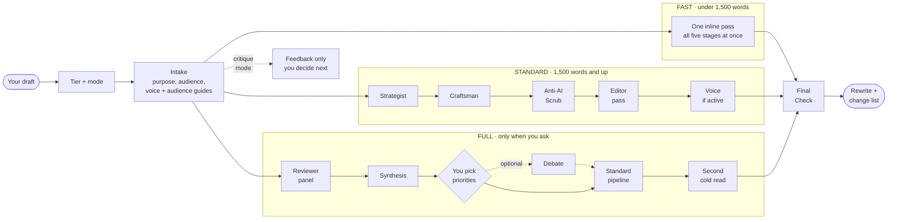

# Rewriter

A skill for Claude Code and Claude Cowork that rewrites raw content into clean business prose, or critiques a draft without rewriting it. It can match a specific voice (yours, a publication's, a brand's) and aim at a specific reader through an audience guide.

Three separate dials control a run:

- **Mode**: what kind of help you want. Five critique modes run on a spectrum from wide open to finished: Inspire, Provoke, Clarify, Nudge, and Polish (the full rewrite).
- **Tier**: how much machinery runs. Fast (one pass), Standard (the full editing pipeline), or Full (adds a reviewer panel and a debate).
- **Intensity**: how far a rewrite departs from your draft, from 1 (light polish) to 5 (rebuilt from scratch).

The editing pipeline itself has five stages: a Strategist finds the point, a Craftsman rebuilds the sentences, an Anti-AI Scrub removes machine-generated style, the Editor checks coherence and fidelity to the source, and an optional Voice Layer applies a voice guide.

## What it does

You give it rough text: notes from a call, a first draft, a ChatGPT dump, anything. It returns prose that reads like a human wrote it for Harvard Business Review. Or, if you've built a voice guide, it returns prose that reads like *you* wrote it.

The pipeline cuts word count by 40-60% with zero information loss. It does this by finding the buried lead, restructuring around it, tightening every sentence, and killing the vocabulary and patterns that mark AI-generated text.

## Install

**Claude Cowork (desktop/web app):** download `rewriter.zip` from the [latest release](../../releases/latest). In the app, go to **Customize > Skills**, remove any old version of rewriter, then upload `rewriter.zip` and toggle it on. Cowork installs a snapshot and does not auto-update, so re-upload to pick up new versions.

**Claude Code (CLI):** clone this repo into `~/.claude/skills/rewriter/`, or point Claude Code at the folder, then restart your session. Skills load at session start.

## Usage

Type `/rewriter` in Claude Code, or ask Claude to "rewrite this" / "clean this up" / "make this professional" / "rewrite in my voice."

The skill asks one question before starting: do you want to provide context about audience and purpose, or should it jump straight in? If you share details, it runs a short intake interview (purpose, audience, intensity level 1-5). If not, it starts editing immediately.

**Critique modes.** Ask for feedback instead of a rewrite ("critique this," "will this land?") and the rewriter offers five modes, matched to how finished the draft is:

1. **Inspire** (wide open): raw material, no angle yet. You get possible directions and ideas to borrow.
2. **Provoke** (open): an angle that plays it safe. You get "what if" challenges and the strongest objection.
3. **Clarify** (narrowing): good material pulling in several directions. You get the one-sentence core idea and a check on whether the opening leads with it.
4. **Nudge** (focused): a settled idea. You get a first-time read as your target reader, likely objections, and a numbered list of improvements to accept by number.
5. **Polish** (nearly done): the full rewrite, plus a numbered change list you can revert by number.

The first two open up options, the next two narrow them, and Polish finishes. The rewriter explains this spectrum whenever it offers a mode, recommends one, and lets you choose. A plain "rewrite this" goes straight to Polish. The mode names come from the Modes of Critique framework developed at IDEO Chicago (around 2016); the descriptions and procedures here are this skill's own.

**Tiers:**

- **Fast**: one inline pass, no sub-agents. Automatic under 1,500 words.
- **Standard**: the full multi-stage pipeline below. Automatic at 1,500 words and up.
- **Full**: Standard plus a reviewer panel (Strategist, Craftsman, Scrub, Cold Reader, Skeptic, Plain-English Reader, Voice Keeper), an optional debate where reviewers disagree, and a second cold read of the result. Only when you ask ("full mode," "dial it to 11").

Step-by-step detail for each tier is in [How each tier runs](#how-each-tier-runs).

**Audience guides.** Alongside voice guides, the rewriter can load an audience guide: who the reader is, what they know, the terms they use, what they want, and what makes them skeptical. See `audiences/README.md` and `references/audience-guide-template.md`.

**Intensity levels:**

- **1-2**: Light polish. Preserves your structure and voice. Tightens without reimagining.
- **3**: Editor's judgment. Restructures where needed, leaves what works.
- **4-5**: Full rewrite. Finds the point, restructures around it, rebuilds from scratch.

## The pipeline

Every run starts and ends the same way. The middle depends on the tier. Critique modes other than Polish stop after intake with feedback and wait for your decision.

Each stage is described below. For the step-by-step version of each tier, see [How each tier runs](#how-each-tier-runs).

### Stage 1: Strategist

Finds the point. Restructures around it. Does not touch sentences.

Draws on Steven Pinker's classic style (orient the reader's gaze toward something real) and Chip Heath's Commander's Intent (if everything else falls away, what survives?). Asks six questions of the input before changing a word: What is this showing the reader? What's the one thing that matters? Where's the gap? Am I assuming too much? Is this concrete or abstract? Does it break a pattern?

### Stage 2: Craftsman

Rebuilds sentences word by word. The register is sharp analyst, not marketer.

Draws on Verlyn Klinkenborg's sentence-level craft and Strunk & White's structural rules: active voice, positive form, concrete language, omit needless words, emphatic endings. Kills transitions, kills zombie nouns, varies sentence rhythm.

### Stage 3: Anti-AI Scrub

Removes every pattern that flags text as AI-generated.

Fetches the latest [Wikipedia guide to AI writing signs](https://en.wikipedia.org/wiki/Wikipedia:Signs_of_AI_writing) (updated regularly as LLM behavior changes) and scans for: cursed vocabulary, negative parallelisms, rule-of-three lists, em dash overuse, editorial commentary, compulsive summaries, hedging pileups, promotional tone, copula avoidance, dangling significance, legacy inflation, vague attributions, elegant variation, and the "one of the most" formula.

Before the word-level scan it runs four structural checks that a clean vocabulary pass misses: prose that comments on its own argument ("The good news is measurable"), lines that could drop into any keynote, corporate nouns that point at nothing, and overcompletion, where the draft finishes a story the source left unfinished.

### Stage 4: Editor pass

Checks coherence (do paragraphs follow?), tone (does it sound like one voice?), completeness (did anything get lost?), precision (are claims specific?), and format compliance (right length, register, structure for the stated purpose). It also checks fidelity: any fact, number, date, weekday, or total that is not in the source gets cut, and when an audience guide is active, it reads the draft as that reader. A small script (`scripts/final_check.py`) flags dashes, cursed words, "not X, it's Y" constructions, and numbers that don't appear in the source. If voice is not active, this is the final output. If voice is active, passes to Stage 5.

### Stage 5: Voice Layer (optional)

Transforms the polished output into a specific voice: a person, a publication, or a brand.

Reads a voice guide and applies the voice's actual patterns: idea architecture, sentence rhythm, word palette, register calibration, and anti-patterns. Voice guide patterns with direct-quote evidence override Scrub rules. Global user rules (CLAUDE.md) override everything. After the Voice Layer, the Editor does one final verification scan before delivering.

## Voice matching

The rewriter can write in any voice (a person, a publication, or a brand) if you build a voice guide first.

### Voice types

- **Person voice:** How a specific individual speaks and writes. Built from transcripts, emails, slides, blog posts.
- **Publication voice:** The editorial style of a newsletter, blog, or content series. Built from published articles and editorial guidelines.
- **Brand voice:** How an organization communicates. Built from marketing materials, style guides, and past campaigns.

### Building a voice guide

Run `/rewriter voice-analyze` or tell Claude "build a voice profile." The Voice Analyzer walks you through:

1. **Identify voice type**: person, publication, or brand. This determines source types.
2. **Gathering sources**: transcripts, emails, and slides for people. For publications: articles, style guides. More variety produces a better guide.
3. **Dispatching analysis agents**: parallel agents analyze sources across dimensions (idea architecture, sentence patterns, word palette, etc.)
4. **Synthesis**: findings merge into a structured voice guide covering idea architecture, sentence patterns, word palette, register dials, and anti-patterns.
5. **Review**: you read the guide and confirm it captures the voice.

The output is saved as a voice guide file the rewriter auto-detects during intake. It looks in the skill's `voices/` folder, a shared `~/.claude/skills/voices/` library, and a `voice-guides/` folder in your workspace (see [`voices/README.md`](voices/README.md)). Multiple voice guides can coexist; the rewriter lists all available voices and lets you choose.

### Privacy

Real voice guides are gitignored by default. Your voice stays on your machine. The skill ships the `voices/` folder with a README and one fictional `EXAMPLE.md` so voice matching works the moment you install it, but never anyone's actual voice.

## How each tier runs

Every run, in every tier, starts and ends the same way:

- **Start:** the rewriter picks the tier, then the mode (a plain "rewrite this" goes straight to Polish). It offers a short intake (purpose, audience, how much change you want), looks for a voice guide and an audience guide, and asks which to use if more than one fits.
- **End:** the Final Check script scans the finished text for dashes, cursed words, "not X, it's Y" constructions, and numbers that aren't in your source. A Polish rewrite then arrives with a numbered list of the meaningful changes, and you can undo any of them by number ("revert 2").

What happens in between depends on the tier.

### Fast (automatic under 1,500 words)

One pass, no sub-agents. The rewriter does all the work itself in a single sitting:

1. Reads every reference file at once (Pinker, Heath, Klinkenborg, Strunk & White, the anti-AI checklist), plus the voice and audience guides if active.
2. Keeps intake brief. For an obvious job like "rewrite this email," it may skip the questions and just confirm the format. The voice and audience checks still run.
3. Rewrites once, applying every stage's thinking as it goes: find the point and fix the structure (Strategist), tighten sentences and rhythm (Craftsman), remove structural and word-level AI tells (Scrub), check every fact against the source and avoid overcompletion (Editor), and apply the voice guide if one is active.
4. Runs the Final Check and delivers one clean draft plus the change list. No intermediate drafts unless you ask.

Why 1,500 words: below that, all the reference material (about 35K tokens) plus your input and the output fit comfortably in one attention window, so splitting the work adds two or three minutes without adding quality. For a short but dense piece (technical, several sections, mixed tones) the rewriter may choose Standard anyway.

A critique mode in the Fast tier also runs inline, in one pass.

### Standard (automatic at 1,500 words and up)

The full pipeline, with each stage run by its own focused sub-agent so it can give the job full attention. Each stage produces a complete draft that feeds the next:

1. **Strategist** finds the point and restructures around it, without touching sentences. Uses the audience guide and, if you ran Clarify first, your confirmed one-sentence core idea.
2. **Craftsman** rebuilds the sentences: active voice, concrete words, no needless words or transitions, varied rhythm.
3. **Anti-AI Scrub** fetches the live Wikipedia guide, runs the structural checks, then the word-level scan.
4. **Editor pass** (the rewriter itself) checks coherence, tone, completeness, fidelity to the source, overcompletion, the audience, and format.
5. **Voice Layer** (only if a voice guide is active) applies the voice, followed by one more verification scan.

Then the Final Check and the change list. If you disagree with the result, you can ask to see each stage's draft to find where it went wrong. In critique modes, Standard can run Nudge's cold read and objections as parallel sub-agents.

### Full (only when you ask: "full mode," "run a panel," "dial it to 11")

Everything in Standard, plus a reviewer panel before the rewrite and a second check after it. It is the slowest and most expensive tier, so the rewriter never picks it on its own.

1. **Panel proposal.** The rewriter proposes four to six reviewers suited to this draft, with a reason for each and a note on who it's leaving out, and waits for you to confirm. The seven available reviewers:
   - **Strategist:** one clear, concrete point, pitched at what the reader knows.
   - **Craftsman:** sentence economy, rhythm, active verbs.
   - **Scrub:** AI tells, including the structural ones.
   - **Cold Reader:** your target reader's first read, in order, noting where they stumble, doubt, or drift.
   - **Skeptic:** a smart outsider who extends no goodwill: objections, unsupported claims, insider shorthand.
   - **Plain-English Reader:** a capable non-expert flagging jargon and undefined terms.
   - **Voice Keeper:** only with a voice guide; does it sound like that person or publication?
2. **Parallel review.** Each reviewer reads the draft separately, with only its own reference material, and returns quoted passages, problems, suggested fixes, and severity.
3. **Synthesis.** The rewriter combines the reviews into: issues several reviewers agree on; tensions where they disagree (both positions, and what's at stake); single-reviewer insights worth keeping; a numbered priority list; and the one hard question the reviewers circled without asking.
4. **Your decision.** You pick which priorities to act on, by number, and settle the tensions.
5. **Debate (optional, only if you say yes).** For each tension, each reviewer sees the other side's argument and concedes, holds, or offers a compromise, for up to three rounds. Each tension ends resolved, at a stalemate, or with a proposal on the table. Anything unresolved comes back to you; the debate informs your call and never makes it.
6. **Rewrite.** The Standard pipeline runs with your decisions as instructions.
7. **Second cold read.** The Cold Reader and Skeptic read the finished draft once more, and anything that still stops the read gets fixed before the Final Check and change list.

In critique modes, Full runs Nudge as this reviewer panel.

## Example

**Input** (AI-generated):

> In the ever-evolving landscape of the electric vehicle industry, Tesla, Inc. stands as a beacon of innovation and disruption. It is worth noting that Tesla's journey from a niche EV startup to one of the most valuable companies on the planet has been nothing short of remarkable, and its executive leadership team plays a pivotal role in navigating the complex challenges and exciting opportunities that lie ahead.

**Output** (after pipeline):

> Tesla's revenue fell for the first time in company history in 2025. Full-year sales dropped to $94.8 billion from $97.7 billion. Q4 net income fell 61%, to $840 million.

67 words became 30. Every fact survived. The filler didn't.

## Reference files

The skill includes nine reference files that the sub-agents consult at their respective stages:

| File | Stage | Source |
|---|---|---|
| `pinker-clarity.md` | Strategist | Steven Pinker, *The Sense of Style* (2014) |
| `heath-stickiness.md` | Strategist | Chip & Dan Heath, *Made to Stick* (2007) |
| `klinkenborg-sentences.md` | Craftsman | Verlyn Klinkenborg, *Several Short Sentences About Writing* (2012) |
| `strunk-white-elements.md` | Craftsman | Strunk & White, *The Elements of Style*, 4th ed. (2000) |
| `anti-ai-checklist.md` | Scrub (fallback) | Distilled from [Wikipedia:Signs of AI writing](https://en.wikipedia.org/wiki/Wikipedia:Signs_of_AI_writing) |
| `voice-guide-template.md` | Voice Layer | Template for building voice guides |
| `critique-modes.md` | Critique modes | Mode names from IDEO Chicago's Modes of Critique (around 2016); procedures adapted in part from Every's compound-writing (MIT) |
| `audience-guide-template.md` | Intake | Adapted from Every's compound-writing AUDIENCE.md template (MIT) |
| `panel-and-debate.md` | Full tier | Adapted from Every's compound-writing panel and debate workflows (MIT) |

## Edge cases

- **Input is already polished.** Skips the Strategist and Craftsman. Sends straight to the Scrub.
- **Input has no discernible point.** Asks the user: "What's the one thing you want the reader to take away?"
- **User wants to preserve their voice.** At intensity 1-2, the Craftsman tightens without imposing a new voice.
- **User wants a specific voice applied.** If a voice guide exists in `voices/`, the Voice Layer runs after the Editor pass. Multiple guides are listed for the user to choose from.
- **User disagrees with the rewrite.** Shows intermediate stages (Strategist, Craftsman, Scrub, Voice) so you can pinpoint where it went wrong.
- **Input is over 5,000 words.** Applies the pipeline section by section.
- **Voice guide conflicts with style rules.** Voice wins. If the voice guide has direct-quote evidence that the voice genuinely uses a construction, the Voice Layer preserves it.

## Changelog

### 1.3 (2026-11-08)
- **Critique modes.** Five modes (Inspire, Provoke, Clarify, Nudge, Polish) matched to how finished a draft is. Each critique mode stops at a decision point before anything is rewritten; Polish adds a numbered change list you can revert by number. The rewriter explains the spectrum whenever it offers a mode.
- **Three tiers.** Fast (one pass), Standard (full pipeline), Full (adds a reviewer panel, optional debate, and a second cold read; only on request).
- **Audience guides.** A new input next to voice guides, found in three locations like voices, with a template that requires a basis for every observation and a shared-vocabulary section.
- **New structural AI tells.** Argument self-commentary, portable profundity, corporate abstraction, and overcompletion (certainty inflation, tidy causes, unearned endings) in the Scrub and the Editor's fidelity check.
- **Fidelity for derived facts.** Dates, weekdays, and totals the rewriter works out itself now count as new facts and must trace to the source. `scripts/final_check.py` flags numbers that are not in the source.
- **Learning loop.** When you reject the same kind of edit twice, the rewriter proposes a rule for your voice or audience guide and writes nothing without your yes.

### 1.2.1 (2026-06-18)
- **Voice guides now ship and persist.** The whole `voices/` folder was gitignored, so it never traveled when the skill was installed. Voice matching silently fell back to neutral on any machine but the author's. The folder now ships with a README and a fictional `EXAMPLE.md`; only real guides stay gitignored.
- **Cowork support.** Voice guides are discovered in three locations (the skill's `voices/`, a shared `~/.claude/skills/voices/`, and a `voice-guides/` folder in the workspace), and the Voice Analyzer saves to a persistent workspace location in Cowork, where the skill folder can be reset between sessions.
- **No silent fallback.** When only the example is present, the rewriter treats it as "no voice guide" and offers to build one instead of quietly going voice-neutral.

### 1.2 (2026-03-25)
- **Multi-voice types**: Voice guides now support persons, publications, and brands (not just individuals)
- **Publication voice support**: Voice Analyzer handles article-based analysis for editorial/newsletter voices
- **Voice guide template**: Updated with publication/brand compression tables and voice-type metadata
- **Multiple voices**: Rewriter auto-detects and lists all guides in `voices/` during intake

### 1.1 (2026-03-24)
- **Voice matching**: Voice Layer (Stage 4) transforms output into a specific voice using voice guides
- **Voice Analyzer**: Sub-skill (`VOICE-ANALYZER.md`) builds voice guides from transcripts, emails, slides, and other writing samples
- **Fast mode**: Inputs under 1,500 words skip sub-agents, run the full pipeline as a single pass
- **Voice guide template**: Structured template (`references/voice-guide-template.md`) for building voice profiles
- Anti-AI scrub applied to all documentation

### 1.0 (2026-03-23)
- Initial release: Strategist, Craftsman, Anti-AI Scrub pipeline
- Five reference files (Pinker, Heath, Klinkenborg, Strunk & White, anti-AI checklist)
- Intake interview with intensity levels 1-5

## License

MIT. See [LICENSE](LICENSE).

## Acknowledgements

This skill stands on other people's thinking. Our thanks to:

- **IDEO Chicago**, where the Modes of Critique framework was developed around 2016. The five mode names (Inspire, Provoke, Clarify, Nudge, Polish) and the idea of matching feedback to how finished a draft is come from that work. The descriptions, prompts, and procedures here are our own. [ideo.com](https://www.ideo.com)
- **[Every](https://every.to)** and its [compound-writing](https://github.com/EveryInc/compound-writing) project. The audience guide template, the panel and debate workflows, the cold-reader and objection checks, the lede-placement test, and the structural AI tells (argument self-commentary, overcompletion) are adapted from it under the MIT License. The full notice is in [licenses/compound-writing-MIT.txt](licenses/compound-writing-MIT.txt).
- **Katie Parrott**, whose "Compound Writing" talk at Every's Thesis conference (November 2026) prompted the critique modes and audience guides in version 1.3.
- **The editors of [Wikipedia:Signs of AI writing](https://en.wikipedia.org/wiki/Wikipedia:Signs_of_AI_writing)**, a guide the Anti-AI Scrub fetches live on every run.
- **The writers on our shelf:** Steven Pinker (*The Sense of Style*), Chip and Dan Heath (*Made to Stick*), Verlyn Klinkenborg (*Several Short Sentences About Writing*), and William Strunk Jr. and E. B. White (*The Elements of Style*). The reference files summarize their ideas in our words; read the books.

## Built by

[Remix Partners](https://remixpartners.ai). We help companies turn generative AI from sideline experiments into growth engines.
